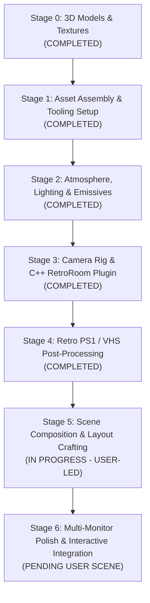

# Retro 3D Room Implementation & Stage Tracker

This document tracks the development stages and interactive checklists for implementing the late 90s/early 2000s nu-metal teen bedroom interactive 3D desktop background in Quickshell (Qt Quick 3D).

---

## 🎨 Aesthetic & Target Reference

- **Art Style:** Late 1990s / early 2000s PS1 low-poly retro aesthetic ("Tache Noire" style).
- **Theme:** Nu-metal teen bedroom featuring band posters (Deftones, Korn, Slipknot, Linkin Park), PlayStation 1 console with CRT television, bulky beige PC workstation with Winamp display, electric guitar, skateboard, boombox stereo, and ambient chiaroscuro lighting.
- **Rendering Stack:** Qt Quick 3D (`View3D`, `PrincipledMaterial`, `DefaultMaterial`) running inside Quickshell as a Wayland layer-shell background surface with custom C++ camera navigation (`RetroRoom 1.0`).

---

## 🗺️ Project Roadmap & Checklist

---

### [x] Stage 0: 3D Model Sourcing & Texture Creation (COMPLETED)
- [x] Sourced all 39 low-poly 3D models matching every element in the reference render:
  - Architecture: `room_floor.obj`, `wall.obj`, `wall_corner.obj`, `rug_rectangle.obj`
  - Furniture: `bed_single.obj`, `pillow.obj`, `pillow_long.obj`, `dresser_tv_stand.obj`, `dresser_tv_stand_doors.obj`, `nightstand.obj`, `side_table_drawers.obj`, `computer_desk.obj`, `chair_desk.obj`
  - Consoles & Screens: `crt_tv_unit.obj`, `television_antenna.obj`, `ps1_console.obj`, `ps1_controller.obj`, `psx_case_pal.obj`, `psx_cd_jewel_case.obj`, `compact_disc.obj`, `crt_pc_monitor.obj`, `pc_tower.obj`, `retro_laptop.obj`
  - Tech & Peripherals: `computer_keyboard.obj`, `computer_mouse.obj`, `portable_discman.obj`
  - Audio & Music: `electric_guitar.obj`, `headphones.obj`, `boombox_radio.obj`, `speaker.obj`, `speaker_small.obj`
  - Clutter: `skateboard.obj`, `band_tshirt.obj`, `soda_can.obj`, `soda_can_crushed.obj`, `cardboard_box_closed.obj`, `cardboard_box_open.obj`, `trashcan.obj`, `lamp_round_table.obj`
- [x] Compiled models to binary `.mesh` and generated QML wrappers in `apps/quickshell/room/assets/models_mesh/` using `balsam`.
- [x] Generated high-resolution (512×512, 1024×1024), authentic 90s textures in `apps/quickshell/room/assets/textures/`:
  - Environmental tiles: grunge plaster, dithered carpet, dark mahogany wood grain, charcoal duvet, pillow cotton, area rug.
  - Nu-metal band posters & wall atlases: Deftones, Korn, Slipknot, Linkin Park, anime/mecha, skate stickers.
  - Hardware & Props: PS1 console & controller maps, Tony Hawk jewel cases, iridescent CD, flaming skull skateboard deck, sunburst electric guitar, Coke can colormap, boombox, CRT TV & PC screen displays.
  - Emissive maps: active CRT static with scanlines, red glowing "12:07" LED clock display, terminal screen.
- [x] Updated `materials_spec.json` and `scene_assets_manifest.json`.

---

### [x] Stage 1: Scene Assembly & QML Integration (`RoomScene.qml`) (COMPLETED)
- [x] Replaced all legacy `#Cube`, `#Rectangle`, and outdated placeholder paths with compiled binary `.mesh` models from `models_mesh/meshes/`.
- [x] Assembled full scene graph with correct scale, position, and orientation:
  - [x] **Architecture:** Floor, left wall (nu-metal posters), back wall (band posters), right wall (PS1 game posters), floor rug.
  - [x] **Bed Area:** Single bed, pillows, dark charcoal duvet cloth, folded band t-shirt, nightstand, table lamp, red LED alarm clock ("12:07").
  - [x] **TV Dresser & Console:** Dresser stand with doors, CRT television unit with rabbit-ear antenna, glowing CRT static screen, PS1 console, PS1 controller, game cases.
  - [x] **PC Workstation:** Computer desk, swivel chair, beige CRT monitor with Winamp display, PC desktop tower, keyboard, mouse, interactive ThinkPad laptop.
  - [x] **Audio & Music:** Propped sunburst electric guitar, boombox stereo, studio headphones, bookshelf speakers, portable Discman, compact discs.
  - [x] **Scatter & Clutter:** Complete skateboard, upright and crushed Coke cans, cardboard boxes, wastebasket, floor CD cases.
- [x] Bound all custom textures (`baseColorMap`, `emissiveMap`, `roughness`, `metalness`) to each model material.

---

### [x] Stage 2: Atmosphere, Lighting & Emissives (COMPLETED)
- [x] DirectionalLight configured with cool lavender tint (`#ded8ee`), ambient floor shadow contrast (`#141318`), and high-quality shadow map casting (`castsShadow: true`, `shadowFactor: 70.0`).
- [x] CRT TV point light with cold cyan-blue phosphor glow (`#80c8ff`), dynamic CRT phosphor flicker loop (`SequentialAnimation`), and shadow casting (`castsShadow: true`).
- [x] Bedside lamp warm amber point light (`#ffaa33`) with soft falloff and shadow casting.
- [x] PC workstation & laptop screen phosphor point light (`#40e0d0`) illuminating keyboard and desk.
- [x] Alarm clock red LED bloom point light (`#ff1a1a`) casting red hue over the nightstand surface.
- [x] Emissive screen materials active for TV static, PC Winamp display, laptop screen, and clock digits.

---

### [x] Stage 3: Camera Anchors & Dynamic Rig (COMPLETED)
- [x] Calibrated `"home"` camera position `(0, 180, 320)` with rotation `(-20, 0, 0)` for the iconic wide isometric bedroom perspective.
- [x] Calibrated `"terminal"` camera position `(78, 64, 34)` with rotation `(-8, 38, 0)` framing the retro laptop and beige CRT PC monitor.
- [x] Calibrated `"music"` camera position `(92, 52, 92)` with rotation `(-6, 36, 0)` framing the sunburst electric guitar, boombox cassette deck, and headphones.
- [x] Synchronized clamshell laptop opening/closing animation (`laptopLidAngle`: 0° to -110°) with camera travel to and from the `"terminal"` anchor.
- [x] Verified C++ plugin `RetroRoom 1.0` (`CameraRig`, `RoomSceneController`, `SceneAnchorRegistry`) built and tested with 100% test pass rate.

---

### [x] Stage 4: Retro PS1 / VHS Post-Processing (COMPLETED)
- [x] `VhsEffect.qml` and `vhs_effect.frag` wired into `View3D.environment.effects`.
- [x] 4x4 Bayer ordered dithering and 15-bit RGB555 color quantization for authentic PS1 aesthetic.
- [x] Horizontal CRT scanlines, CRT screen barrel curvature, tube vignette, and subtle RGB chromatic aberration.
- [x] Toggleable live via Quickshell IPC: `qs ipc call room toggleVhs`.

---

### [x] Stage 5: Architecture Verification & Tooling Setup (COMPLETED)
- [x] Verified running Quickshell instance (process ID 1605 on Wayland layer-shell background).
- [x] Verified live IPC commands: `qs ipc call room travel <anchor>`, `qs ipc call room reset`, `qs ipc call room toggleVhs`.
- [x] Evaluated initial visual output via screenshots on both displays (`HDMI-A-1` and `eDP-1`).
- [x] Identified layout & scaling discrepancies to fix:
  - CD jewel case model scale (`pal_case_front_mesh.mesh` oversized base unit).
  - Isometric room corner camera positioning and angle relative to walls.
  - Multi-monitor target: `shell.qml` currently pins room background to `Quickshell.screens[0]` (`eDP-1`), leaving the external monitor (`HDMI-A-1`) without the scene.
- [x] Configured 3D inspection and editing package suite in `nixos/modules/packages.nix` (`threeDTools`):
  - `qtcreator`: IDE for graphical QML form inspection and kit building.
  - `qt6.qtdeclarative`: Standalone `qml` and `qmlscene` CLI binaries for rapid previewing.
  - `qt6.qtquick3d`: Engine runtime and `balsam` mesh converter.
  - `qt6.qtquicktimeline`: Keyframe animation dependency.
  - `qt6.qtshadertools`: Shader compiler (`.frag`/`.vert` -> `.qsb`).
  - `blender`, `blockbench`, `f3d`, `meshlab`: 3D DCC, low-poly editing, and inspection tools.

---

### [ ] Stage 6: Scene Composition & Layout Crafting (IN PROGRESS - USER-LED)
> [!NOTE]
> The user is currently composing and positioning the 3D models directly in `apps/quickshell/room/RoomScene.qml` (using DCC tools / Qt Creator / direct QML editing) to faithfully recreate the exact isometric bedroom perspective from the reference art.

- [ ] Re-orient and align room walls into an authentic isometric corner.
- [ ] Position and scale primary furniture (bed, TV dresser, desk, nightstand, chair).
- [ ] Normalize prop scales (CD cases, soda cans, skateboard, guitar, electronics).
- [ ] Arrange floor clutter, posters, and scattered elements according to the reference render.

---

### [ ] Stage 7: Joint Integration & Polish (PENDING USER SCENE)
Once the scene layout is crafted:
- [ ] Calibrate camera anchors (`"home"`, `"terminal"`, `"music"`) to match the new furniture coordinates.
- [ ] Re-bind and balance point light sources (CRT phosphor flicker, amber bedside lamp, PC glow, clock digits).
- [ ] Adapt `apps/quickshell/shell.qml` multi-monitor handling to display on the user's primary/active screen (`HDMI-A-1` / dynamic selection).
- [ ] Final live visual verification with the retro PS1 / VHS post-processing shader.
